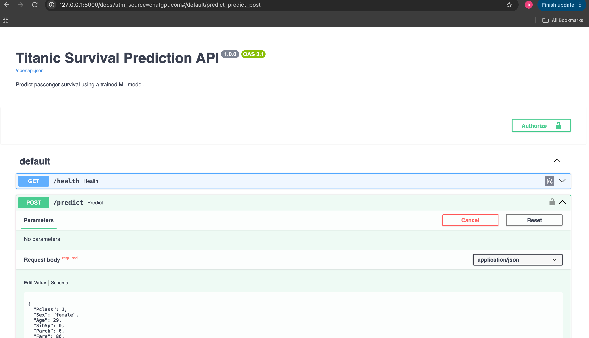
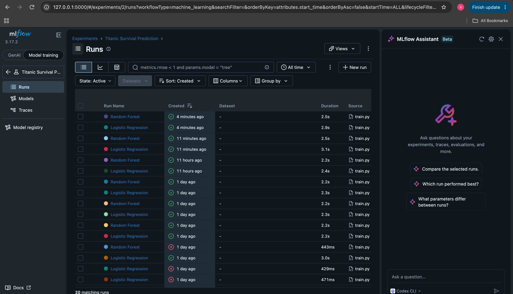

# Titanic Survival Prediction — MLOps Project Report

## 1. Introduction

This project focuses on predicting passenger survival during the Titanic disaster using machine learning and implementing an end-to-end MLOps workflow.

The system integrates data preprocessing, classification, experiment tracking, dataset versioning, automated testing, API serving, and model monitoring.

## 2. Project Objectives

- Develop a classification model for Titanic passenger survival.
- Evaluate predictive performance using standard classification metrics.
- Maintain reproducible experiments and datasets.
- Automate testing and training workflows.
- Provide predictions through FastAPI.
- Monitor model behavior using Evidently AI.

## 3. Methodology

### Data Exploration and Preprocessing

The Titanic dataset contains 891 passenger records. Missing values were identified in Age, Cabin, and Embarked.

Missing numerical values are handled using median imputation, while missing categorical values are handled using the most frequent category.

Feature engineering introduced FamilySize and IsAlone. Numerical features are scaled and categorical features are encoded.

### Model Development

Logistic Regression and Random Forest were trained using Scikit-learn pipelines.

Models were evaluated using accuracy, precision, recall, F1-score, and ROC-AUC.

### Model and Data Versioning

MLflow was used to log training parameters, evaluation metrics, and model artifacts.

DVC was introduced to track the original and processed datasets.

### CI/CD

GitHub Actions workflows were configured for automated testing, training, evaluation, and artifact generation.

### Deployment

FastAPI was used to create a REST API with health-check and prediction endpoints.

Pydantic validates incoming passenger data before inference.

### Monitoring

Evidently AI was introduced to monitor feature distribution changes and model performance.

A drift alert script checks for statistically significant changes in monitored features.

## 4. Results and Discussion

### Model Comparison

[model_metrics.json](reports/model_metrics.json)

**Best-performing model:** [Insert model name]

**Best F1-score:** [Insert value]

**ROC-AUC:** [Insert value]

### Model Interpretation

Discuss which passenger features are most influential using a properly calculated feature importance or coefficient analysis.

### API Results

### Experiment Tracking

### Monitoring Results

[monitoring_report.html](screenshots/monitoring_report.html)
## 5. Challenges Encountered

Several technical issues arose during implementation:

1. Custom Scikit-learn transformer serialization caused a model loading error. This was addressed by moving FeatureEngineer into an importable module.
2. MLflow model logging raised an untrusted-types error. Trusted types were explicitly configured for the project's known model classes.
3. MLflow raised warnings concerning integer columns and missing values. Numerical model inputs were converted to floating-point types.
4. Evidently classification configuration initially used a dictionary where a classification configuration object was required.

These challenges demonstrated the importance of compatible dependencies, consistent model serialization, and reproducible environments.

## 6. Lessons Learned

- Data preprocessing should be part of the model pipeline.
- Experiment tracking makes model comparisons easier.
- Data and model versioning improve reproducibility.
- Automated testing reduces deployment risks.
- API validation helps prevent invalid inference requests.
- Monitoring is necessary to detect changes after model deployment.

## 7. Limitations and Future Recommendations

The project uses a small historical dataset and demonstrates monitoring with a fixed test dataset.

Future improvements include cloud deployment, real-time prediction logging, hyperparameter optimization, continuous deployment, and automated retraining.

## 8. Conclusion

The Titanic Survival Prediction project demonstrates how machine learning development can be integrated with MLOps practices.

The resulting system provides a structured workflow for preparing data, training and evaluating classification models, tracking experiments, versioning datasets, serving predictions, and monitoring model behavior.
